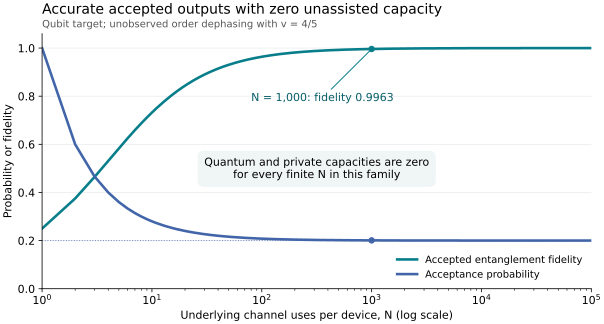

# Communication consequences and resource accounting

The cyclic-order construction can produce an accurate accepted transmission from channels that individually erase their input completely. The operational question is whether the entire device supports an asymptotic communication rate when every invocation, including an unsuccessful outcome, is counted. The answer depends on the allowed assistance.

The [channel model](channel_model.md) fixes the physical construction. The [ideal boundary](ideal_boundary.md) classifies its antidegradability exactly, and the [unobserved-dephasing theorem](unobserved_dephasing.md) gives an obstruction that persists for every number of cyclic orders. This page explains the capacities, comparisons and costs to which those results apply.

## 1. What zero capacity means

For a fixed effective channel, the sender may encode a logical quantum system jointly into arbitrarily many target inputs, and the receiver may decode jointly from all target and controller outputs. The quantum capacity $`Q`$ is the largest asymptotically reliable rate in this unassisted model. No preshared entanglement or classical return channel is supplied.

An antidegradable channel admits a channel from its complementary environment to the receiver's output. Consequently, if the receiver could reliably recover a positive-rate quantum message, the environment could reproduce that recovery, contradicting the impossibility of broadcasting arbitrary quantum states. This conclusion concerns unrestricted coding over repeated uses; it is stronger than a negative value of one selected coherent-information expression.

The private classical capacity $`P`$ uses the standard wiretap convention: the eavesdropper holds the full complementary output. For an ensemble labelled by a classical variable $`X`$, data processing under an antidegrading map gives

```math
I(X;B)\le I(X;E).
```

The same inequality holds for every block because tensor products and receiver postprocessings preserve antidegradability. The regularized private-information expression therefore has no positive rate. Thus

```math
Q=P=0
```

throughout each proved antidegradable regime. The complementary environment includes purifications of mixed preparation and inaccessible control noise. A different wiretap model in which some noise is trusted and hidden from the eavesdropper requires its own privacy analysis.

The [controller simulation](channel_model.md) also covers arbitrary fixed controller correlations across a block of disjoint devices, provided their joint preparation factors from the complete encoded target/reference input. The resulting block output is a receiver postprocessing of a tensor product of uniform-controller channels. Correlated preparation therefore does not evade these conclusions. Adaptive controller–target interactions, a message-bearing controller and a bypass carrying the target are different models.

## 2. Exact boundary and a useful baseline

For ideal uniform control, the complete cyclic-order channel is antidegradable exactly when

```math
N\le N_*=(d^2-1)^2.
```

All allowed controller preparations inherit zero quantum and private capacity in that region. Above it, the uniform channel is not antidegradable. Its capacity is not determined by this theorem.

A simpler sufficient argument treats each flag branch separately. The accepted branch has normalized Choi Bell overlap

```math
F_0=\frac{N}{N+d^2-1}.
```

The standard two-copy shareability criterion for isotropic states gives antidegradability of this branch when $`F_0\le(d+1)/(2d)`$, equivalently $`N\le(d+1)^2`$. The other branch has zero Bell overlap and is antidegradable. Mixing the two independently antidegradable branches, with the flag retained, gives the simpler sufficient bound. The complete-channel proof permits joint allocations between the two output flags and reaches a substantially larger region.

| Target dimension $`d`$ | Separate-branch sufficient bound | Exact complete-channel boundary |
| --- | ---: | ---: |
| 2 | 9 | 9 |
| 3 | 16 | 64 |
| 4 | 25 | 225 |
| 5 | 36 | 576 |
| 6 | 49 | 1225 |

The ideal qubit endpoint is already reached by the simpler argument. The dimension-dependent improvement is from order $`d^2`$ to order $`d^4`$. Its Bell-overlap ingredients are inherited from the isotropic-state compatibility literature; the exact allocation for the cyclic flagged channel is established in the [boundary proof](ideal_boundary.md). See [related work](../references/RELATED_WORK.md) for the precise comparison.

At the exact endpoint,

```math
p_0=\frac{1}{d^2-1},\qquad
F_0=1-\frac{1}{d^2}.
```

The accepted entanglement fidelity approaches one as the target dimension grows, while the complete device still has zero unassisted capacities. In this example, acceptance simultaneously becomes rare and the number of underlying channel calls grows. These costs are part of the statement.

## 3. Fixed-dimension accuracy with zero capacity

The noise model is the actual channel $`\mathcal D_v=v\,\mathrm{id}+(1-v)\Delta_C`$ on the order register, with its environment inaccessible to the receiver. It is not a general characterization of all physical controller errors by one visibility number.

For

```math
v\le\frac{d^2}{d^2+1},
```

the [noise theorem](unobserved_dephasing.md) establishes antidegradability for every finite $`N`$. For any fixed $`v>0`$, the accepted branch nevertheless approaches the identity as $`N`$ grows, with success probability approaching $`v/d^2`$.

For the qubit example $`d=2`$, $`v=4/5`$, the noise channel mixes complete order-register dephasing with weight $`1/5`$. This is not a claim of a 20 percent Pauli phase-flip probability or a hardware gate-error threshold.

| Cyclic orders $`N`$ | Acceptance probability | Accepted entanglement fidelity | Accepted pure-state fidelity |
| --- | ---: | ---: | ---: |
| 10 | 0.280000 | 0.732143 | 0.821429 |
| 100 | 0.208000 | 0.963942 | 0.975962 |
| 1,000 | 0.200800 | 0.996265 | 0.997510 |
| 1,000,000 | 0.200001 | 0.999996 | 0.999998 |

The complete device has $`Q=P=0`$ in every row. Entanglement fidelity tests preservation of one half of a maximally entangled state; pure-state fidelity tests an individual pure input. They are different conventions, and both are shown to make the comparison unambiguous.



The curves evaluate the exact formulas at integer order counts. The noise environment is unavailable to the receiver, and private capacity uses the full complementary environment. [Plot source](../verification/plot_example.py).

The formal limiting channel has a fixed binary-flag output space and is approached in diamond norm. It is used to prove a statement about finite devices. It is not an implementable infinite-order operation with a finite cost. For $`v`$ above the stated ceiling, sufficiently large finite uniform-controller channels cease to be antidegradable, but this does not establish positive capacity.

## 4. Heralding and classical feedback

The receiver can retain the accepted outputs and report their locations to the sender when a classical return channel is available. That changes the communication resource. Chiribella, Wilson and Chau established positive two-way-assisted capacity for the cyclic construction when $`N\ge d+2`$, as well as the accurate heralded branch. Their full-device statement is explicitly assisted; the present zero-unassisted-capacity result is compatible with it. See [their primary paper](https://arxiv.org/abs/2005.00618).

The unsuccessful branch is a quantum channel,

```math
\mathcal E_1(\rho)=\frac{dI-\rho}{d^2-1}
```

under ideal control. It retains input-dependent quantum output and is not a literal erasure symbol. An erasure-channel analogy explains why good heralded performance need not imply a positive unassisted rate, but it does not supply this exact antidegradability boundary.

## 5. Which resources are charged

| Resource | Convention and consequence |
| --- | --- |
| Underlying noisy channels | One effective invocation uses $`N`$ independent completely depolarizing slots; a block of $`m`$ devices uses $`mN`$ slots. |
| Order register | There are $`N`$ orthogonal order labels. At least $`\lceil\log_2N\rceil`$ qubits are needed to encode them, before accounting for routing hardware. |
| Controller preparation | Fixed independently of the complete encoded input; correlations and retained preparation ancillas are included in the domination theorem. |
| Receiver output | The entire target, controller and allowed preparation ancilla are retained. Discarding any part cannot increase capacity. |
| Unsuccessful outcomes | Included in the effective channel and in every rate denominator. |
| Classical feedback and shared entanglement | Not supplied to the unassisted capacities; assisted tasks are distinguished explicitly. |
| Control-noise environment | Unavailable to the legitimate receiver; included in the standard complementary environment for the private-capacity statement. |
| Hardware, time and coherent routing | No claim of optimal gate count, circuit depth, optical efficiency, runtime or implementation advantage is made. |

At fixed $`N`$, zero capacity per effective invocation is also zero per underlying slot. Even in an assisted heralded task, the accepted-pair yield per slot is $`p_0/N`$, before purification or encoding costs. A nonzero limiting acceptance probability at fixed dimension does not make that per-slot yield constant as $`N`$ grows.

## 6. Reproduce the finite examples

The [verification guide](../verification/README.md) explains the independent Kraus enumeration, explicit extension checks, correlated-controller simulation and finite examples. The saved numerical report records the tested scope and tolerances. These checks support the analytical proofs and do not replace them or determine any capacity outside the proved regions.
